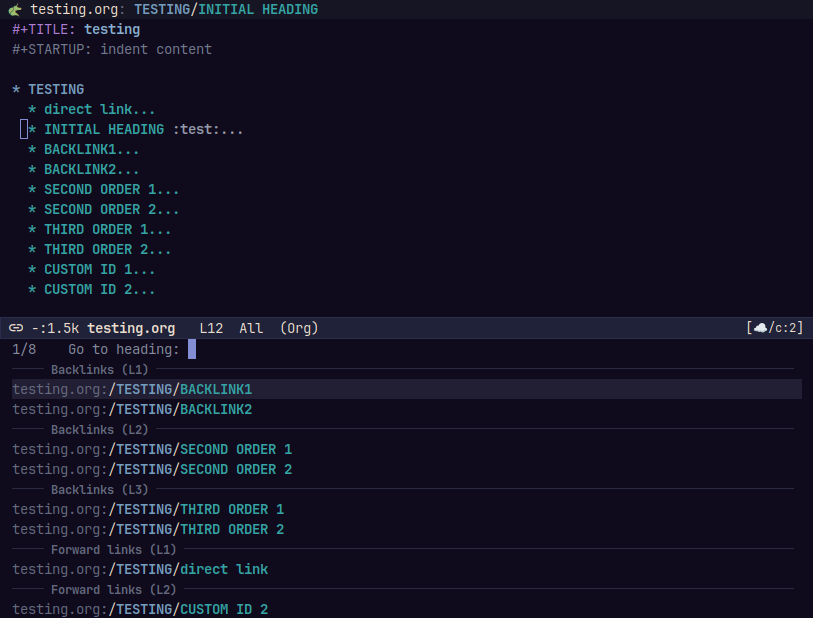
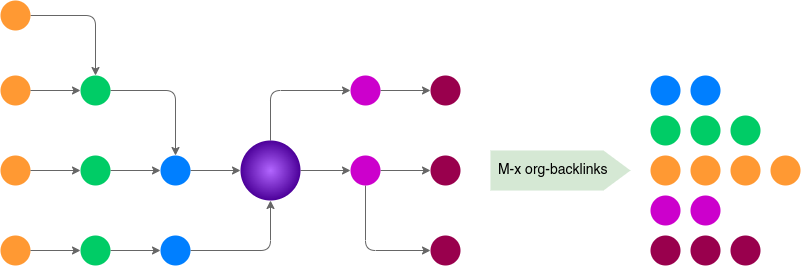
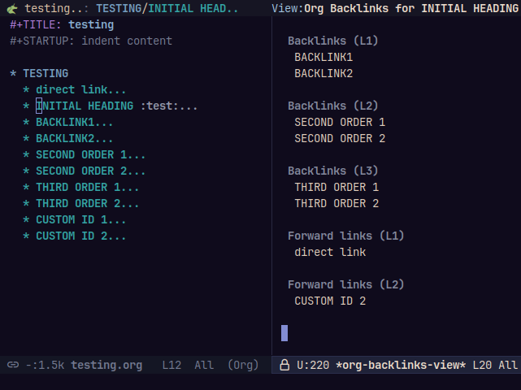

#+AUTHOR: Bruno Cardoso <cardoso.bc@gmail.com>
#+DATE: 2022-03-05
#+STARTUP: indent content

* org-backlinks

An interface for searching backlinks to Org headings.

This package aims to provide a sense of context when searching for links /to/ and /from/ the current note.

Backlinks are the Org headings that have links to the current heading at point. It's possible to search for backlinks at any arbitrary depth (backlinks of backlinks, and so on).

Forward links are the links present in the current heading; they can also be followed to further levels (the links of those headings, and so on).

By default, =org-backlinks= searches for three levels of backlinks, and two of forward links.

** Installation

This package requires Emacs 29.1+ and [[https://github.com/alphapapa/org-ql][org-ql]].

*** Manual

Clone this repo and add it to your =load-path=:

#+begin_src emacs-lisp
(add-to-list 'load-path "/path/to/org-backlinks")
(require 'org-backlinks)
(require 'helm-org-backlinks)    ; Optional Helm interface
#+end_src

*** With straight.el

#+begin_src emacs-lisp
(use-package org-backlinks
  :straight (org-backlinks :host github :repo "bcardoso/org-backlinks"
                           :files ("org-backlinks.el"))
  :bind (("C-c z" . org-backlinks)
         ("C-c Z" . org-backlinks-view)))

;; Optional Helm interface
(use-package helm-org-backlinks
  :straight (helm-org-backlinks :host github :repo "bcardoso/org-backlinks"
                                :files ("helm-org-backlinks.el"))
  :bind ("C-c z" . helm-org-backlinks))
#+end_src

*** With elpaca

#+begin_src emacs-lisp
(use-package org-backlinks
  :ensure ( :host github :repo "bcardoso/org-backlinks"
            :files ("org-backlinks.el"))
  :bind (("C-c z" . org-backlinks)
         ("C-c Z" . org-backlinks-view)))
#+end_src

** Usage

Just run =M-x org-backlinks= in an Org heading. The completion interface will display the backlinks and forward links of the current heading, grouped by direction and depth. With =C-u=, =org-backlinks= prompts for both depths.

=org-backlinks= will search the files defined in =org-backlinks-scope= for links to the =ID= or =CUSTOM_ID= properties of the current Org heading. The default search depths are defined in =org-backlinks-depth=.

Other customizable variables are accessible through =M-x customize-group RET org-backlinks=.

Alternatively, command =org-backlinks-view= presents the relevant links to/from a Org heading in a [[https://github.com/alphapapa/org-ql][org-ql]] view buffer.

** Arbitrary link types

By default, =id:= links are matched against the =ID= property, =file:= links with a =#custom-id= search option against =CUSTOM_ID=, and =cite:= references (which are not actual links) against =CUSTOM_ID= as well.

See the docstring of =org-backlinks-link-types= for more details.

Now suppose you have defined a custom link parameter (say, =my=) that depends on the values of a specific Org property (say, =MY_ID=).

#+begin_src emacs-lisp
(org-link-set-parameters "my" :follow #'my-follow-function)
#+end_src

This way, for example, following a link like =my:123= would lead you to an Org heading where the value of property =MY_ID= is "123".

(Note that the implementation of "my-follow-function" is irrelevant, as it is not called by =org-backlinks=. What matters is that the link type is registered, so =org-element-map= can find its links.)

With enough links among your notes, it might be useful to see the structure of backlinks and other indirect links for the current heading. This way, custom links are treated like =id:= links in both backlink and forward-link searches.

To include an arbitrary link type, along with the default =ID= and =CUSTOM_ID= properties, just add a definition to =org-backlinks-link-types=:

#+begin_src emacs-lisp
(add-to-list 'org-backlinks-link-types '("my" "MY_ID"))
#+end_src

** Integrations

The main =org-backlinks= command is a completing-read interface that integrates well with [[https://github.com/minad/vertico][Vertico]] and [[https://github.com/minad/consult/][Consult]], and the default [[https://github.com/oantolin/embark][Embark]] actions for Org headings also work on the candidates list.

A simple source for level-1 backlinks is already defined in =org-backlinks-consult-source=, so it can be added into other Consult commands.

The optional package =helm-org-backlinks= provides an alternative [[https://github.com/emacs-helm/helm][Helm]] interface for =org-backlinks=.

** Changelog

- v0.4.0 :: Complete refactor, support for citation references, and =org-backlinks-view= command.
  - There are many breaking changes, so existing configurations must be reviewed.
  - The previously optional package =consult-org-backlinks= is no longer needed and was removed from this version. The same functionality is now available in the main =org-backlinks= command.

- v0.3.0 :: Add support for arbitrary link types.

- v0.2.0 :: Add [[https://github.com/minad/consult/][Consult]] support.

- v0.1.0 :: Initial concept & [[https://github.com/emacs-helm/helm][Helm]] interface.
